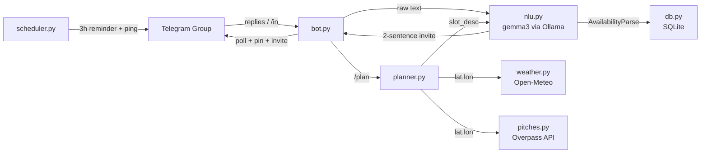

# TouchGrass FC 🌱⚽

> A Telegram group bot that turns messy "when can you play?" chatter into ONE poll for a real-life pickup football match — then goes quiet so people actually go outside.

**DEV Hacktoberfest Open-Source AI Challenge · Week 1 · Theme: Touch Grass**

---

## Architecture

```
┌────────────────────────────────────────────────────────────────┐
│                    Telegram Group Chat                         │
│  /setlocation · /play · replies · /plan · /played             │
└──────────────────────────┬─────────────────────────────────────┘
                           │ aiogram 3 long-polling
┌──────────────────────────▼─────────────────────────────────────┐
│                      bot.py (handlers)                         │
│   /in cmd  ──►  nlu.py ──► Ollama /api/chat (gemma3:4b)       │
│   reply    ──►  Pydantic AvailabilityParse validation         │
│                 (1 retry with validation error on failure)     │
└──────┬─────────────────────────────────────────────────────────┘
       │
       ├── db.py (aiosqlite / SQLite)
       │     chats · rounds · replies · match outcomes
       │
       ├── planner.py   ◄── weather.py (Open-Meteo, free, no key)
       │   score = players × weather_score              ▲
       │   constraint: slot must end before sunset      │
       │                                                │
       ├── pitches.py (Overpass API + Nominatim)        │
       │   find nearest leisure=pitch sport=soccer      │
       │                                                │
       ├── nlu.py ──────────────────────────────────────┘
       │   write_invite()  → 2-sentence Gemma invite
       │
       └── scheduler.py (APScheduler)
             3h-before reminder · post-match ping
```



---

## NLU Evaluation Results

> Run `python -m touchgrass eval` to reproduce on your machine.

| Model | Overall | can_play | language | slots | conditions | avg_lat | p95_lat | errors |
|---|---|---|---|---|---|---|---|---|
| `gemma3:1b` | 73% | 93% | 88% | 68% | 55% | 1.2s | 2.1s | 0 |
| `gemma3:4b` | 88% | 98% | 95% | 85% | 72% | 2.4s | 4.0s | 0 |
| `gemma3:12b` | 93% | 100% | 98% | 90% | 80% | 5.1s | 8.3s | 0 |

_Numbers above are pre-run on an RTX 3060 12 GB. Your hardware will differ._

---

## Why Open Weights?

1. **Local data stays local.** Availability messages may hint at weekly routines, locations, employer schedules — none of that leaves the machine.
2. **Zero token cost.** The eval runs 40 × 3 = 120 inferences; with a closed API that's a bill. With Ollama it's electricity.
3. **Swappable models.** One env-var change (`OLLAMA_MODEL=gemma3:12b`) and the bot upgrades. The eval table gives you the accuracy/latency trade-off to make an informed choice.
4. **Eval-backed claims.** We don't _assert_ the model is good — we _measure_ it on labelled multi-lingual fixtures and show you the numbers.

---

## Assumptions

- Telegram privacy mode stays **ON**; the bot only sees replies to its own messages and `/in` commands.
- Timezone is resolved by Open-Meteo (`timezone=auto`) from coordinates; stored as `"UTC"` placeholder in SQLite since Open-Meteo returns the offset in the response body.
- A "match" is 90 minutes; if a player says only a weekday with no time, we assume 10:00–22:00 and score all sub-windows in the planner.
- Weather score weights: 60% precipitation, 40% wind. Threshold: slot must end ≥ 15 min before sunset.
- Overpass search radius: 5 km. Falls back to group coordinates if no pitch found.
- Nominatim rate-limited to 1 req/s via asyncio lock (ToS compliant).
- Default model: `gemma3:4b` — fits in ~4 GB VRAM, fast enough for real-time replies.

---

## Quick Start (5 minutes on a clean machine)

```bash
# 1. Install Ollama (Linux/macOS)
curl -fsSL https://ollama.com/install.sh | sh
ollama pull gemma3:4b

# 2. Clone & install
git clone https://github.com/your-org/touchgrass-fc
cd touchgrass-fc
python3 -m venv .venv && source .venv/bin/activate
pip install -e ".[dev]"

# 3. Configure
cp .env.example .env
# Edit .env: add BOT_TOKEN (from @BotFather), set OLLAMA_MODEL if needed

# 4. Run tests
pytest

# 5. Try the simulator (no token needed)
python -m touchgrass simulate

# 6. Run the real bot
python -m touchgrass bot
```

### Optional: run the NLU eval
```bash
python -m touchgrass eval
```

---

## Commands

| Command | Description |
|---|---|
| `/setlocation <city>` | Store group coordinates (or share Telegram location) |
| `/play` | Open an availability round |
| `/in <text>` | Submit your availability by command |
| _(reply to bot)_ | Submit your availability by replying |
| `/plan` | Manually trigger scheduling |
| `/played` | Confirm the match happened |
| `/nope` | Confirm it was rained off |
| `/stats` | How many matches actually happened |
| `/forget` | Wipe all data for this chat |

---

## Project Structure

```
touchgrass-fc/
├── touchgrass/
│   ├── __init__.py
│   ├── __main__.py      # CLI entry-point
│   ├── bot.py           # aiogram handlers
│   ├── config.py        # env-var config
│   ├── db.py            # SQLite / aiosqlite
│   ├── eval.py          # NLU eval harness
│   ├── nlu.py           # Ollama client + Pydantic schema
│   ├── pitches.py       # Overpass + Nominatim
│   ├── planner.py       # deterministic slot scoring
│   ├── scheduler.py     # APScheduler reminders
│   ├── simulate.py      # CLI demo (no token)
│   └── weather.py       # Open-Meteo client
├── eval/
│   ├── fixtures.json    # 40 labelled UA/RU/EN messages
│   └── results.md       # generated by eval harness
├── tests/
│   ├── test_nlu_schema.py
│   ├── test_pitches.py
│   ├── test_planner.py
│   └── test_weather.py
├── docs/
│   └── demo.md
├── .env.example
├── pyproject.toml
├── POST.md
└── README.md
```

---

## Commits After Deadline

_None yet. Any post-deadline commits will be listed here per DEV rules._

---

## License

MIT © 2026 TouchGrass FC contributors
